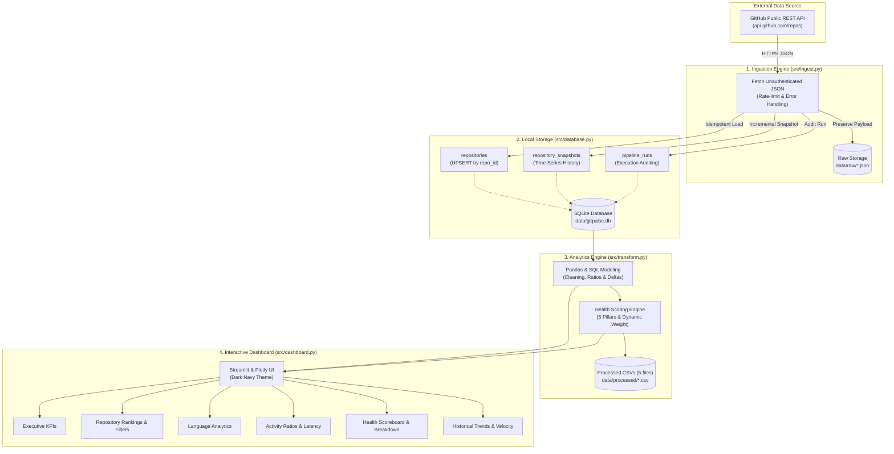

# ⚡ GitPulse

> **A Local-First GitHub Analytics ELT Pipeline, Time-Series Tracker & Explainable Health Scoring Dashboard**
> Built with Python 3.12, SQLite, pandas, requests, Streamlit, Plotly, and pytest. Completely free, with no paid APIs, cloud services, Docker, or external database servers.

[](https://github.com/Bhagyaashreee/GitPulse/actions/workflows/ci.yml)
[](https://www.python.org/downloads/release/python-3120/)
[](LICENSE)
[](https://streamlit.io)
[](https://www.sqlite.org)
[](https://plotly.com)

---

## 📖 Overview

**GitPulse** is a lightweight, local-first ELT (Extract, Load, Transform) data pipeline designed to ingest public GitHub repository metadata, persist time-series snapshots to an embedded SQLite database, perform analytical modeling using pandas, and present interactive engineering metrics through a dark-themed Streamlit dashboard.

The entire system runs on a local machine, using only the unauthenticated GitHub REST API and standard local file storage. It eliminates complex infrastructure overhead—requiring zero Docker containers, zero external database servers, and zero paid API keys—while adhering to data engineering best practices including idempotent ingestion, payload audit preservation, time-aware metric velocity modeling, and dynamic weight normalization.

---

## 🌟 Key Engineering Highlights

- **Zero-Cost Ingestion Engine (`src/ingest.py`)**: Fetches live repository metadata directly from the unauthenticated GitHub REST API. Features rate-limit circuit breaking (evaluating `X-RateLimit-*` headers) and exponential backoff to operate reliably within the 60 requests/hour unauthenticated quota.
- **Audit-Preserving Raw Storage (`data/raw/`)**: Dumps full, untouched JSON API responses with UTC timestamps, guaranteeing historical auditability and reproducibility.
- **Idempotent Relational Storage (`src/database.py`)**: Uses SQLite with strict foreign key constraints and `ON CONFLICT(repo_id) DO UPDATE SET` (UPSERT) logic to guarantee idempotency across repeated ingestion cycles. Logs every pipeline run with execution status (`COMPLETED`, `PARTIAL`, `FAILED`), error details, and ingested repository counts.
- **Longitudinal Trend & Velocity Modeling (`src/transform.py`)**: Calculates consecutive snapshot step deltas (`delta_stars`, `delta_forks`, `delta_open_issues`) and computes daily star growth velocity ($\text{stars}/\text{day}$) using true elapsed time between collection events, with division-by-zero protection.
- **Explainable Heuristic Health Scoring (`src/transform.py`)**: Evaluates repository health on a 0–100 scale across 5 transparent pillars. Normalizes dynamically over available signals so missing metadata or single snapshots never unfairly penalize scores.
- **Automated Multi-Dataset Exports (`data/processed/`)**: Automatically exports 5 structured CSV datasets upon transformation, maintaining stable schemas even on empty databases.
- **Modern Interactive Dashboard (`src/dashboard.py`)**: Dark navy UI featuring executive KPIs, interactive scatter and latency charts, language summaries, a multi-repository Health Scoreboard with expandable pillar inspector, and a chronological snapshot audit trail.
- **Rigorous Test Suite (`tests/`)**: 46 automated unit and integration tests executing against isolated SQLite database fixtures (`tmp_path`) and mocked API/UI components, validated continuously via GitHub Actions CI.

---

## 🏗️ Architecture



---

## 🛡️ Repository Health Scoring Framework

GitPulse includes an explainable, heuristic repository health scoring system that maps observable metadata signals to an intuitive composite index (0–100) and letter grades.

> [!NOTE]
> **Heuristic Disclosure:** The health score is a heuristic index based on public repository metadata, maintenance recency, and collection velocity. It is **not** a direct code-quality audit (e.g., test coverage, cyclomatic complexity, or vulnerability scanning).

### The Five Heuristic Pillars

| Pillar | Max Weight | Observable Signals & Evaluation Criteria | Missing Data Handling |
| :--- | :---: | :--- | :--- |
| **1. Maintenance Recency** | 35 pts | Days since last GitHub update (`days_since_update`):<br>• $\le 14$ days: 35 pts (very active)<br>• $\le 45$ days: 30 pts (active)<br>• $\le 90$ days: 22 pts (regular)<br>• $\le 180$ days: 15 pts (moderate)<br>• $\le 365$ days: 8 pts (slow)<br>• $> 365$ days: 0 pts (stale / inactive > 1 yr) | If update timestamp is missing or unparseable, pillar status is set to `DATA_UNAVAILABLE` and its 35 points are **excluded from the denominator**. |
| **2. Backlog Pressure\*** | 25 pts | Issue and PR backlog density relative to stars ($(\text{issues} / \text{stars}) \times 100$):<br>• $\le 2\%$: 25 pts (responsive triage)<br>• $\le 5\%$: 20 pts (manageable backlog)<br>• $\le 10\%$: 15 pts (moderate backlog)<br>• $\le 20\%$: 8 pts (heavy backlog)<br>• $> 20\%$: 3 pts (critical backlog debt)<br>• **Zero-Star Protection:** 0 issues = 25 pts; $\le 5$ issues = 18 pts; $> 5$ issues = 10 pts | Evaluated from repository metadata. Status is `AVAILABLE`. |
| **3. Community Adoption** | 20 pts | Evaluates community traction across two sub-dimensions:<br>• **Star Volume (10 pts):** $\ge 10\text{k}$ (10 pts), $\ge 2.5\text{k}$ (8 pts), $\ge 500$ (6 pts), $\ge 100$ (4 pts), $< 100$ (2 pts)<br>• **Fork Engagement (10 pts):** Fork-to-star ratio $\ge 10\%$ (10 pts), $\ge 5\%$ (6 pts), $\ge 2\%$ (2 pts), $< 2\%$ (0 pts). Zero-star repos: 0 forks = 0 pts; $> 0$ forks = 5 pts | Evaluated from repository metadata. Status is `AVAILABLE`. |
| **4. Project Hygiene** | 10 pts | Evaluates baseline metadata completeness:<br>• Non-empty repository description: 5 pts<br>• Designated primary language (not Unknown/None): 5 pts | Evaluated from repository metadata. Status is `AVAILABLE`. |
| **5. Observed Snapshot Trends** | 10 pts | Evaluates observed trajectory across collection cycles:<br>• **Star Growth (5 pts):** Delta $> 0$ (5 pts), $= 0$ (3 pts), $< 0$ (1 pt)<br>• **Issue Burndown (5 pts):** Delta $< 0$ (5 pts - burn-down), $= 0$ (4 pts), $> 0$ (2 pts) | Requires $\ge 2$ collection snapshots. If $< 2$ snapshots exist, status is `INSUFFICIENT_DATA` and its 10 points are **excluded from the denominator**. |

*\* Semantics Notice: In the GitHub REST API, `open_issues_count` combines both open issues and open pull requests.*

### Dynamic Available-Weight Normalization

Rather than penalizing repositories with an unfair zero when metadata or snapshot history is unavailable, GitPulse normalizes scores dynamically over the sum of available component weights ($W_{\text{available}}$):

$$\text{Health Score} = \text{round}\left(100 \times \frac{\sum S_{\text{earned}}}{W_{\text{available}}}\right) \quad (\text{when } W_{\text{available}} \ge 40)$$

$$\text{Data Coverage} = W_{\text{available}}\%$$

If fewer than 40% of the maximum signals are available ($W_{\text{available}} < 40$), the repository is not assigned a score or grade; instead, it returns `health_score = None`, `health_grade = 'N/A'`, and `notes = 'Insufficient signals available (< 40% coverage)'`.

### Grade Bands

| Grade | Score Band | Operational Interpretation |
| :---: | :---: | :--- |
| **A** | **90 – 100** | **Exceptional Health:** Highly active maintenance, responsive backlog, strong adoption, complete hygiene. |
| **B** | **75 – 89** | **Good Health:** Well-maintained project with healthy community engagement and manageable backlog. |
| **C** | **60 – 74** | **Moderate Health:** Active project exhibiting elevated backlog debt or slower update intervals. |
| **D** | **40 – 59** | **At Risk:** Substantial backlog accumulation or dormant maintenance cadence (> 6 months). |
| **F** | **0 – 39** | **Critical / Inactive:** Stale (> 1 year without updates) or severe unaddressed issue debt. |
| **N/A** | *N/A* | **Insufficient Signals:** Data coverage is below 40%; insufficient observable data to score fairly. |

---

## 📈 Historical Snapshot Analytics & Star Velocity

GitPulse captures longitudinal repository snapshots on each ingestion run to measure how metrics evolve over time.

- **Consecutive Step Deltas**: Computes metric progression between consecutive collection points:
  $$\Delta \text{stars} = \text{stars}_t - \text{stars}_{t-1}, \quad \Delta \text{forks} = \text{forks}_t - \text{forks}_{t-1}, \quad \Delta \text{issues} = \text{issues}_t - \text{issues}_{t-1}$$
- **Elapsed Time Tracking**: Measures the exact interval in seconds ($\Delta t$) between consecutive snapshot collection timestamps.
- **Daily Star Growth Velocity**: Computes the rate of star acquisition normalized to days:
  $$\text{Star Velocity} = \frac{\Delta \text{stars}}{\Delta t_{\text{seconds}} / 86400} \quad (\text{stars / day})$$
  *Safeguards:* If consecutive snapshots share identical timestamps ($\Delta t = 0$), velocity is safely reported as `0.0` to avoid division-by-zero.
- **Cumulative Progression**: Tracks total growth from the initial baseline snapshot across all collection cycles.
- **Safe Fallbacks**: Single-snapshot repositories are transparently marked as `INSUFFICIENT_DATA`, while repositories without snapshots are marked as `NO_SNAPSHOTS`.

---

## 📁 Project Structure

```text
GitPulse/
├── .github/
│   └── workflows/
│       └── ci.yml              # GitHub Actions CI workflow (Python 3.12, pytest)
├── .gitignore                  # Ignores .venv, local databases, raw JSON, and processed CSVs
├── requirements.txt            # Pinned dependencies (requests, pandas, streamlit, plotly, pytest)
├── LICENSE                     # MIT License
├── README.md                   # Project documentation and engineering guide
├── docs/
│   ├── overview.md             # Architecture overview and notes
│   └── screenshots/            # Dashboard preview screenshots
│       └── .gitkeep
├── data/
│   ├── raw/                    # Raw JSON API payloads (git-ignored, kept via .gitkeep)
│   │   └── .gitkeep
│   ├── processed/              # Exported analytics CSVs (git-ignored, kept via .gitkeep)
│   │   ├── top_repositories.csv
│   │   ├── language_summary.csv
│   │   ├── repository_activity.csv
│   │   ├── historical_changes.csv
│   │   └── repository_health.csv
│   │   └── .gitkeep
│   └── gitpulse.db             # Embedded SQLite database (git-ignored)
├── src/
│   ├── __init__.py
│   ├── ingest.py               # Unauthenticated GitHub API ingestion engine
│   ├── database.py             # SQLite connection manager, schema, and UPSERT logic
│   ├── transform.py            # Pandas transformations, velocity math, health scoring, CSV export
│   └── dashboard.py            # Streamlit & Plotly interactive analytics dashboard
└── tests/
    ├── __init__.py
    ├── test_ingest.py          # Ingestion, rate limits, timeouts, and API error handling tests
    ├── test_database.py        # Schema, foreign keys, cascade deletes, UPSERT, and run logging tests
    ├── test_transform.py       # Rankings, languages, deltas, star velocity, and health scoring tests
    └── test_dashboard.py       # Dashboard data-loading, health UI, and fallback rendering tests
```

---

## 🛠️ Prerequisites & Setup

### Prerequisites
- **Python 3.12** installed and accessible from your terminal
- **Git**

### Installation

#### Windows (PowerShell)
```powershell
# 1. Clone repository
git clone https://github.com/Bhagyaashreee/GitPulse.git
cd GitPulse

# 2. Create and activate virtual environment
py -3.12 -m venv .venv
.\.venv\Scripts\Activate.ps1

# 3. Install dependencies
pip install --upgrade pip
pip install -r requirements.txt
```

#### macOS / Linux (bash/zsh)
```bash
# 1. Clone repository
git clone https://github.com/Bhagyaashreee/GitPulse.git
cd GitPulse

# 2. Create and activate virtual environment
python3.12 -m venv .venv
source .venv/bin/activate

# 3. Install dependencies
pip install --upgrade pip
pip install -r requirements.txt
```

---

## 🚀 Step-by-Step Usage Guide

### 1. Check GitHub API Rate Limit Quota
Check remaining unauthenticated API requests without consuming any quota:
```bash
python -m src.ingest --check-rate-limit
```

### 2. Ingest Public GitHub Repositories
Fetch real metadata, store raw JSON responses under `data/raw/`, upsert records into `data/gitpulse.db`, and record metric snapshots:
```bash
python -m src.ingest --repos pallets/flask psf/requests fastapi/fastapi django/django encode/httpx
```

### 3. Inspect Local SQLite Database via CLI
Query the database directly from your terminal:
```bash
# View repositories table
python -m src.database --repos

# View historical metric snapshots
python -m src.database --snapshots

# View pipeline execution runs and error audit logs
python -m src.database --runs
```

### 4. Run Transformations & Export Analytics CSVs
Execute analytical modeling and export all 5 processed datasets to `data/processed/`:
```bash
python -m src.transform
```
This generates:
1. `data/processed/top_repositories.csv`: Ranked by stars and forks with joint ranking metrics.
2. `data/processed/language_summary.csv`: Aggregated repositories, stars, and forks by primary language.
3. `data/processed/repository_activity.csv`: Repository age, update latency, and issue-to-star ratio.
4. `data/processed/historical_changes.csv`: Longitudinal star, fork, and issue changes from baseline snapshot.
5. `data/processed/repository_health.csv`: 5-pillar health scores, grades, data coverage, and explanation notes.

### 5. Launch the Interactive Dashboard
Start the local Streamlit analytics application:
```bash
streamlit run src/dashboard.py
```
*Streamlit will automatically open the dashboard in your default browser at `http://localhost:8501`.*

---

## ☁️ Streamlit Community Cloud Deployment

GitPulse is configured for 100% free, zero-cost cloud deployment on [Streamlit Community Cloud](https://streamlit.io/cloud).

### Deployment Configuration Parameters

| Setting Field | Value |
| :--- | :--- |
| **Repository** | `Bhagyaashreee/GitPulse` |
| **Branch** | `main` |
| **Main file path** | `src/dashboard.py` |
| **Python Version** | `3.12` |

### Step-by-Step Cloud Deployment

1. **Commit and Push:**
   Ensure all changes are committed and pushed to GitHub:
   ```bash
   git push origin main
   ```
2. **Access Streamlit Community Cloud:**
   Visit [share.streamlit.io](https://share.streamlit.io/) and sign in with GitHub.
3. **Create a New App:**
   Click **"Create app"** &rarr; **"I already have an app"**.
4. **Enter Application Details:**
   - **Repository:** `Bhagyaashreee/GitPulse`
   - **Branch:** `main`
   - **Main file path:** `src/dashboard.py`
5. **Deploy:**
   Click **"Deploy!"**. Streamlit Cloud builds the container, installs dependencies from `requirements.txt`, and launches your dashboard.
6. **First-Launch Auto-Initialization:**
   - Because `data/gitpulse.db` is intentionally git-ignored, the dashboard automatically initializes a clean SQLite database on startup without crashing.
   - Click **"🚀 Fetch Sample Repositories Now"** (or use the sidebar ingestion panel) to fetch live GitHub data directly in the cloud container. No API keys or external credentials required!

---

## 🧪 Running the Test Suite

The project includes **46 automated unit and integration tests** covering all pipeline layers. Database, ingestion, and transform tests execute against isolated temporary databases (`tmp_path`) to ensure the local database `data/gitpulse.db` is never modified during test runs:

```bash
python -m pytest -v
```

**Test Suite Coverage Summary:**

```text
============================= test session starts =============================
platform win32 -- Python 3.12.10, pytest-9.1.1, pluggy-1.6.0
collected 46 items

tests/test_dashboard.py ..........                                       [ 21%]
tests/test_database.py ..........                                        [ 43%]
tests/test_ingest.py .......                                             [ 58%]
tests/test_transform.py ...................                              [100%]

============================= 46 passed in 6.88s ==============================
```

| Test Module | Test Count | Key Areas Verified |
| :--- | :---: | :--- |
| [tests/test_ingest.py](tests/test_ingest.py) | 7 | REST extraction, schema missing fields, raw JSON dump, rate-limit 403, 404 handling, timeouts |
| [tests/test_database.py](tests/test_database.py) | 10 | Schema creation, UPSERT deduplication, foreign keys, cascade deletes, execution auditing |
| [tests/test_transform.py](tests/test_transform.py) | 19 | Rankings, languages, data quality, snapshot deltas, star velocity math, 5-pillar health scoring, CSV exports |
| [tests/test_dashboard.py](tests/test_dashboard.py) | 10 | Nonexistent/populated DB loading, pipeline refresh, rate limit warnings, health scoreboard rendering |

---

## 📸 Dashboard Screenshots

*(Save screenshots to `docs/screenshots/` to display previews in your GitHub repository)*

| Overview & KPI Metrics | Repository Rankings & Charts |
| :---: | :---: |
|  |  |

| Language Distribution | Historical Trends Timeline |
| :---: | :---: |
|  |  |

---

## 🔒 Data Hygiene & Regeneration

In accordance with data engineering best practices:
- **No runtime data is committed to Git:**
  - `data/gitpulse.db` (local SQLite database) is ignored by `.gitignore`.
  - `data/raw/*.json` (downloaded API responses) is ignored by `.gitignore`.
  - `data/processed/*.csv` (computed analytical views) is ignored by `.gitignore`.
  - The folder hierarchy is preserved in Git using `.gitkeep` files.
- **How to regenerate data from scratch:**
  After cloning this repository on any computer, run:
  ```bash
  python -m src.ingest --repos pallets/flask psf/requests fastapi/fastapi
  python -m src.transform
  ```
  This immediately regenerates the raw JSON payloads, SQLite database tables, and all 5 processed CSV datasets.

---

## ⚠️ Known Limitations & Engineering Tradeoffs

1. **Unauthenticated Rate Limits:** The GitHub REST API allows **60 requests per hour per IP address** for unauthenticated clients. If rate limits are exceeded, `src/ingest.py` raises `GitHubRateLimitError` and displays the exact UTC reset timestamp. Because cloud deployment platforms (such as Streamlit Cloud) share outbound IP addresses across shared containers, the rate limit can occasionally be consumed faster; the app safely detects this and informs users without crashing.
2. **Historical Time-Series Dynamics:** Metric snapshots capture data at the moment of collection. Because real-world repository metrics evolve over days and weeks, repeated ingestion runs are necessary to observe significant star and fork velocity trends. Repositories with only one snapshot are explicitly marked as `INSUFFICIENT_DATA`.
3. **Cloud Ephemeral Storage:** On free cloud tiers like Streamlit Community Cloud, container storage is ephemeral. When a container restarts or goes to sleep after prolonged inactivity, the newly created database reinitializes cleanly with empty tables. Users can repopulate it anytime by clicking **"🚀 Fetch Sample Repositories Now"** or using the sidebar ingestion tool. Local Windows execution retains `data/gitpulse.db` indefinitely.
4. **Heuristic Health Proxy:** The 0–100 health score reflects maintenance recency, issue volume, and community popularity signals. It does not measure internal code architecture, test coverage, or security vulnerabilities.

---

## 🔮 Future Improvements

- Optional GitHub Personal Access Token (PAT) authentication to increase rate limits to 5,000 requests/hour.
- Additional repository endpoints (e.g., commit velocity, contributor counts, pull request closure times).
- Automated export formats including Parquet and DuckDB for larger datasets.
- Configurable repository watchlists loaded from a YAML or JSON file.

---

## 📄 License

This project is licensed under the [MIT License](LICENSE).
