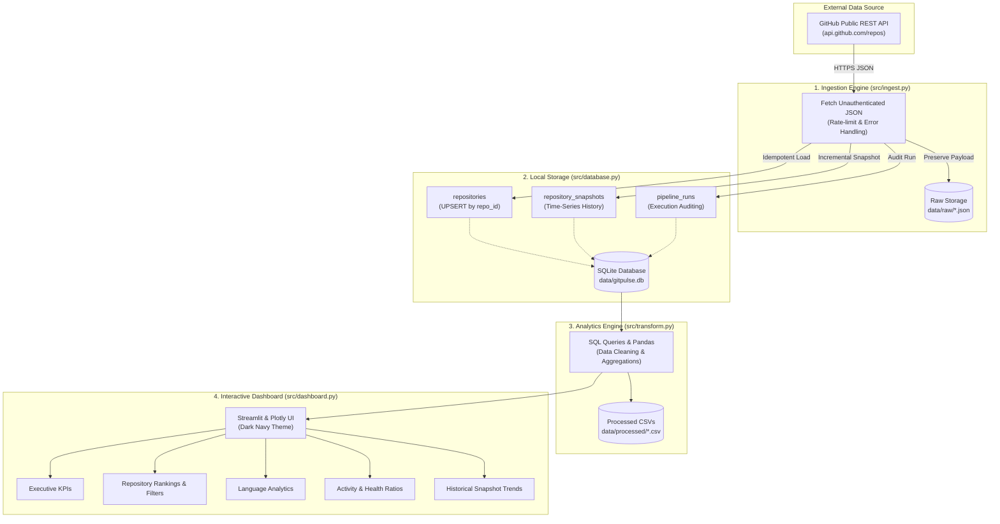

# ⚡ GitPulse

> **A Local-First GitHub Analytics ELT Pipeline & Interactive Dashboard**  
> Built with Python 3.12, SQLite, pandas, requests, Streamlit, Plotly, and pytest. Completely free, with no paid APIs, cloud services, Docker, or external database servers.

---

## 📖 Overview

**GitPulse** is a lightweight, local-first ELT (Extract, Load, Transform) data pipeline designed to ingest public GitHub repository metadata, persist time-series snapshots to an embedded SQLite database, perform analytical modeling using pandas, and present interactive engineering metrics through a dark-themed Streamlit dashboard.

The entire system runs on a local machine, using only the unauthenticated GitHub REST API and standard local file storage.

---

## ✨ Features

- **Unauthenticated REST Ingestion (`src/ingest.py`)**: Fetches repository metadata directly from `https://api.github.com/repos/{owner}/{repo}` without requiring personal access tokens or paid API keys.
- **Resilient Network & Rate Limit Handling**: Gracefully handles network timeouts, 404 missing repositories, schema nulls, and GitHub API unauthenticated rate limits (60 req/hr window) by inspecting `X-RateLimit-*` headers.
- **Raw Payload Preservation (`data/raw/`)**: Stores full, untouched JSON responses locally with UTC timestamps to maintain audit fidelity.
- **Embedded SQLite Storage (`src/database.py`)**:
  - `repositories`: Stores repository attributes with GitHub's numeric repository ID as primary key.
  - `repository_snapshots`: Appends historical snapshots of stars, forks, and issues for longitudinal analysis.
  - `pipeline_runs`: Logs run status (`COMPLETED`, `PARTIAL`, `FAILED`), timestamps, repository counts, and error details.
- **Idempotent Incremental Loading (UPSERT)**: Uses SQLite's `ON CONFLICT(repo_id) DO UPDATE SET` logic to update existing records in-place without duplicate rows.
- **Analytics & Transformations (`src/transform.py`)**:
  - Top repositories ranked simultaneously by stars and forks.
  - Language distribution and aggregate star/fork totals (normalizing missing values as `Unknown`).
  - Repository maintenance latency (`age_days`, `days_since_update`, and issue-to-star ratios).
  - Historical snapshot deltas (`delta_stars`, `delta_forks`, `delta_open_issues`) with single-snapshot safeguards (`INSUFFICIENT_DATA`).
  - Automated CSV export to `data/processed/`.
- **Interactive Streamlit & Plotly Dashboard (`src/dashboard.py`)**:
  - Professional dark navy theme with high-contrast cards and Plotly visualizations.
  - Search and filter controls by name, language, and minimum stars.
  - Real-time **Refresh Analytics** button that recalculates metrics and updates CSV files on demand.
  - Safeguards for empty databases with copy-paste setup instructions.
- **Comprehensive Test Suite (`tests/`)**: 29 automated tests verifying ingestion, database constraints, transformations, data quality, and dashboard data loading using isolated temporary databases (`tmp_path`).

---

## 🏗️ Architecture



---

## 📁 Project Structure

```text
GitPulse/
├── .gitignore              # Ignores .venv, local databases, raw JSON, and processed CSVs
├── requirements.txt        # Minimal pinned dependencies (requests, pandas, streamlit, plotly, pytest)
├── README.md               # Project documentation and reproduction guide
├── docs/
│   ├── overview.md         # Detailed milestone architecture notes
│   └── screenshots/        # Dashboard preview screenshots
│       └── .gitkeep
├── data/
│   ├── raw/                # Untouched raw API payloads (git-ignored, kept via .gitkeep)
│   │   └── .gitkeep
│   ├── processed/          # Exported analytics CSVs (git-ignored, kept via .gitkeep)
│   │   └── .gitkeep
│   └── gitpulse.db         # Local SQLite database (git-ignored)
├── src/
│   ├── __init__.py
│   ├── ingest.py           # Unauthenticated GitHub API ingestion engine
│   ├── database.py         # SQLite connection manager, schema, and UPSERT logic
│   ├── transform.py        # Pandas & SQL transformations and CSV exporter
│   └── dashboard.py        # Streamlit & Plotly interactive analytics dashboard
└── tests/
    ├── __init__.py
    ├── test_ingest.py      # Ingestion, error-handling, and API tests
    ├── test_database.py    # Schema, foreign keys, UPSERT, and run logging tests
    ├── test_transform.py   # Rankings, language grouping, deltas, and data quality tests
    └── test_dashboard.py   # Dashboard data-loading and refresh bridge tests
```

---

## 🛠️ Prerequisites & Setup

### Prerequisites
- **Windows 11** (or Windows 10 / macOS / Linux)
- **Python 3.12** installed and accessible from your terminal

### Windows PowerShell Setup

1. **Clone the repository:**
   ```powershell
   git clone https://github.com/your-username/GitPulse.git
   cd GitPulse
   ```

2. **Create and activate the Python virtual environment:**
   ```powershell
   py -3.12 -m venv .venv
   .\.venv\Scripts\Activate.ps1
   ```

3. **Install dependencies:**
   ```powershell
   pip install --upgrade pip
   pip install -r requirements.txt
   ```

---

## 🚀 Step-by-Step Usage Guide

### 1. Check GitHub Rate Limit Quota
Check your remaining unauthenticated API requests without consuming any quota:
```powershell
python -m src.ingest --check-rate-limit
```

### 2. Ingest Public GitHub Repositories
Fetch real metadata, store raw JSON responses under `data/raw/`, upsert records into `data/gitpulse.db`, and record metric snapshots:
```powershell
python -m src.ingest --repos pallets/flask psf/requests fastapi/fastapi django/django encode/httpx
```

### 3. Inspect Local SQLite Database via CLI
Query the database directly from PowerShell:
```powershell
# View repositories table
python -m src.database --repos

# View historical metric snapshots
python -m src.database --snapshots

# View pipeline execution runs and error audit logs
python -m src.database --runs
```

### 4. Run Transformations & Export Analytics CSVs
Execute analytical aggregations and export cleaned tables to `data/processed/`:
```powershell
python -m src.transform
```
This exports:
- `data/processed/top_repositories.csv`
- `data/processed/language_summary.csv`
- `data/processed/repository_activity.csv`
- `data/processed/historical_changes.csv`

### 5. Launch the Interactive Dashboard
Start the local Streamlit analytics application:
```powershell
streamlit run src/dashboard.py
```
*Streamlit will automatically launch the dashboard in your default browser at `http://localhost:8501`.*

---

## 🧪 Running the Test Suite

The project includes 29 unit and integration tests. All database and transform tests execute against temporary isolated databases (`tmp_path`) to ensure your local `data/gitpulse.db` is never modified during test runs:

```powershell
python -m pytest -v
```

**Expected output:**
```text
============================= test session starts =============================
platform win32 -- Python 3.12.10, pytest-9.1.1, pluggy-1.6.0
rootdir: C:\Users\shree\OneDrive\Desktop\GitPulse
plugins: anyio-4.15.1
collected 29 items

tests/test_dashboard.py::test_load_analytics_data_nonexistent_db PASSED  [  3%]
tests/test_dashboard.py::test_load_analytics_data_populated_db PASSED    [  6%]
tests/test_dashboard.py::test_refresh_pipeline_execution PASSED          [ 10%]
tests/test_database.py::test_db_initialization PASSED                    [ 13%]
tests/test_database.py::test_insert_and_get_repository PASSED            [ 17%]
tests/test_database.py::test_upsert_updates_existing_record_and_prevents_duplicates PASSED [ 20%]
tests/test_database.py::test_insert_snapshot_history PASSED              [ 24%]
tests/test_database.py::test_foreign_key_constraint PASSED               [ 27%]
tests/test_database.py::test_foreign_key_cascade_delete PASSED           [ 31%]
tests/test_database.py::test_pipeline_run_success PASSED                 [ 34%]
tests/test_database.py::test_pipeline_run_with_errors PASSED             [ 37%]
tests/test_database.py::test_ingest_with_database_integration PASSED     [ 41%]
tests/test_database.py::test_ingest_error_does_not_create_snapshot PASSED [ 44%]
tests/test_ingest.py::test_extract_metrics_complete_payload PASSED       [ 48%]
tests/test_ingest.py::test_extract_metrics_missing_or_null_fields PASSED [ 51%]
tests/test_ingest.py::test_save_raw_response PASSED                      [ 55%]
tests/test_ingest.py::test_rate_limit_exceeded PASSED                    [ 58%]
tests/test_ingest.py::test_repository_not_found PASSED                   [ 62%]
tests/test_ingest.py::test_network_timeout PASSED                        [ 65%]
tests/test_ingest.py::test_rate_limit_checker PASSED                     [ 68%]
tests/test_transform.py::test_empty_database_handling PASSED             [ 72%]
tests/test_transform.py::test_rankings_by_stars_and_forks PASSED         [ 75%]
tests/test_transform.py::test_language_summary_and_aggregation PASSED    [ 79%]
tests/test_transform.py::test_data_quality_missing_and_invalid_values PASSED [ 82%]
tests/test_transform.py::test_historical_changes_multi_snapshot PASSED   [ 86%]
tests/test_transform.py::test_historical_changes_single_snapshot PASSED  [ 89%]
tests/test_transform.py::test_historical_changes_zero_snapshots PASSED   [ 93%]
tests/test_transform.py::test_repository_activity_ratios PASSED          [ 96%]
tests/test_transform.py::test_export_all_csv_files PASSED                [100%]

============================= 29 passed in 3.66s ==============================
```

---

## 📸 Dashboard Screenshots

*(Save screenshots to `docs/screenshots/` to display previews in your GitHub repository)*

| Overview & KPI Metrics | Repository Rankings & Charts |
| :---: | :---: |
|  |  |

| Language Distribution | Historical Trends Timeline |
| :---: | :---: |
|  |  |

---

## 🔒 Data Hygiene & Regeneration

In accordance with data engineering best practices:
- **No runtime data is committed to Git:**
  - `data/gitpulse.db` (local SQLite database) is ignored by `.gitignore`.
  - `data/raw/*.json` (downloaded API responses) is ignored by `.gitignore`.
  - `data/processed/*.csv` (computed analytical views) is ignored by `.gitignore`.
  - The folder hierarchy is preserved in Git using `.gitkeep` files.
- **How to regenerate data from scratch:**
  After cloning this repository on any computer, run:
  ```powershell
  python -m src.ingest --repos pallets/flask psf/requests fastapi/fastapi
  python -m src.transform
  ```
  This immediately regenerates the raw JSON payloads, SQLite database tables, and processed CSV datasets.

---

## ⚠️ Known Limitations

1. **Unauthenticated Rate Limits:** The GitHub REST API allows **60 requests per hour per IP address** for unauthenticated clients. If rate limits are exceeded, `src/ingest.py` raises `GitHubRateLimitError` and displays the exact UTC reset timestamp.
2. **Historical Time-Series Dynamics:** Metric snapshots capture data at the moment of collection. Because real-world repository metrics evolve over days and weeks, repeated ingestion runs are necessary to observe significant star and fork velocity trends. Repositories with only one snapshot are explicitly marked as `INSUFFICIENT_DATA`.
3. **Local Scope:** GitPulse is intentionally designed as a local-first desktop analytics tool; it does not include cloud deployment, distributed scheduling, or background worker daemons.

---

## 🔮 Future Improvements

- Optional GitHub Personal Access Token (PAT) authentication to increase rate limits to 5,000 requests/hour.
- Additional repository endpoints (e.g., commit velocity, contributor counts, pull request closure times).
- Automated export formats including Parquet and DuckDB for larger datasets.
- Configurable repository watchlists loaded from a YAML or JSON file.

---

## 📄 License

This project is licensed under the [MIT License](LICENSE).
